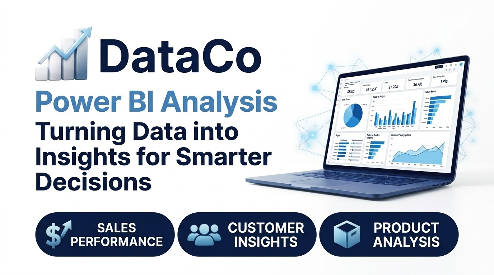

# DataCo Intelligence: Sales, Profit and Delivery Performance Analysis Report (2013–2018) 

 

 ## Executive Summary

This report presents an analysis of DataCo's business performance using a Power BI dashboard. The analysis focuses on sales, profit, product performance, customer segments, geographical markets, and delivery operations.
The dashboard recorded total sales of $36.78 million, total profit of $3.97 million, and total quantity of 384.08 thousand units. The average delivery time displayed was 3.50.
Year-over-year indicators show growth in sales, profit, and quantity. The dashboard also identifies differences in performance across customer segments, product categories, and geographical markets

## Business Context

DataCo operates in a business environment where sales performance, profitability, product demand, and delivery efficiency are important to overall operations.
Understanding these business areas helps management evaluate revenue generation, identify profitable departments, assess customer segment performance, and monitor delivery-related risks.
This analysis uses the DataCo Intelligence dashboard to examine business performance from different perspectives and identify areas that may support better decision-making.

## Objectives

### The analysis focuses on answering the following business questions:

- Evaluate overall sales, profit, and quantity performance.
- Examine year-over-year business growth.
- Identify top-performing products by sales.
- Analyse customer segment contribution.
- Compare sales performance across geographical markets.
- Investigate late delivery risk by region.
- Examine profit contribution by department.
- Identify trends in sales over time.

## Data Overview

The dashboard presents the following business information:

Data Area| Description
Sales| Total sales and year-over-year sales growth
Profit| Total profit and year-over-year profit growth
Quantity| Total quantity and growth
Delivery| Average delivery time and late delivery risk
Products| Product categories and sales performance
Customers| Consumer, Corporate, and Home Office segments
Markets| Europe, LATAM, Pacific Asia, USCA, and Africa
Departments| Fan Shop, Apparel, Golf, Footwear, Outdoors
Time| Sales trends and year-over-year comparisons

The dashboard contains two pages: Home and Deep Dive.

## Key Findings

### The dashboard was designed to investigate:

**Overall Business Performance**
- Total Sales: $36.78M
- Total Profit: $3.97M
- Total Quantity: 384.08K
- Average Delivery Time: 3.50

**Year-over-Year Performance**

Metric| YOY Change
Sales| +43.3%
Profit| +44.6%
Quantity| +33.6%
Delivery| 0.0%

Sales, profit, and quantity recorded positive year-over-year growth.

Customer Segment Distribution

Customer Segment| Share
Consumer| 51.8%
Corporate| 30.35%
Home Office| 17.85%

The Consumer segment contributed the largest share of the displayed segment distribution.

Top Performing Products by Sales

The dashboard identifies the following leading product categories:

- Fishing
- Cleats
- Camping & Hiking
- Cardio Equipment
- Women's Apparel

Fishing recorded the highest sales among the product categories displayed.

Sales by Market
Market| Sales
Europe| $10.87M
LATAM| $10.28M
Pacific Asia| $8.27M
USCA| $5.07M
Africa| $2.29M

Europe recorded the highest sales, followed by LATAM and Pacific Asia

## Dashboard.

## Link to Power BI Report

Click the Link to view the full power BI DashBoard: [CLICK HERE](https://app.powerbi.com/view?r=eyJrIjoiNGFjZTFkMDAtOTZkZS00Y2ExLWIyYjktODliNDhkYTA0NjgzIiwidCI6ImJjN2Y1MzUzLTgxZTYtNDk5My1hZjI4LTBhZGUzNWI4NzU4ZCJ9)

## Data Cleaning and Transformation

All steps were done in Power Query.

Loaded the CSV and renamed the query Deliveries.
Set data types: Order_Date (Date), Dispatch_Time (Time), Delivery_Time_Mins, Delivery_Fee_NGN and Customer_Rating (Whole Number), all others (Text).
Checked for duplicates: all 6,500 Order_IDs unique, no duplicate rows.
Checked text columns for inconsistent casing, spelling and extra spaces: none found.
Kept nulls in Delivery_Time_Mins and Customer_Rating for undelivered orders, rather than replacing them with 0, so averages are not distorted.

## The analytical preparation process included:

- Reviewing the dataset structure and available fields.
- Identifying data quality issues.
- Preparing relevant columns for analysis.
- Organising data for business reporting.
- Transforming data into a suitable structure for visualization.
- Preparing measures and calculations for performance analysis.

## Detailed Findings & Analysis
Sales and Profit Performance

DataCo recorded $36.78 million in total sales and $3.97 million in total profit.

The year-over-year indicators show sales growth of 43.3% and profit growth of 44.6%. Profit growth was slightly higher than sales growth, indicating an improvement in the displayed profit performance relative to sales.

Customer Segment Analysis
The Consumer segment accounted for 51.8% of the displayed segment distribution, making it the largest customer segment.

Corporate customers contributed 30.35%, while Home Office accounted for 17.85%.

This distribution shows that the Consumer segment represents the largest share of the customer mix shown in the dashboard.

Product Performance

Fishing was the leading product category by sales, generating approximately $6.9 million.

Other leading categories included:

Product Category| Sales
Fishing| $6.9M
Cleats| $4.4M
Camping & Hiking| $4.1M
Cardio Equipment| $3.7M
Women's Apparel| $3.1M

The results indicate that sales were concentrated among several leading product categories.

Geographical Market Analysis

Europe generated the highest sales at $10.87 million, closely followed by LATAM at $10.28 million.

Pacific Asia recorded $8.27 million, while USCA and Africa recorded $5.07 million and $2.29 million respectively.

The dashboard therefore shows Europe and LATAM as the two leading markets by sales.

Late Delivery Risk Analysis

The Deep Dive page identifies the following regions with late delivery risk:

Region| Displayed Risk
Western Europe| 15K
West of USA| 4K
West Asia| 3K
US Center| 3K
West Africa| 2K

Western Europe recorded the highest displayed late delivery risk.

Profit by Department

Department| Displayed Profit
Fan Shop| 67K
Apparel| 49K
Golf| 33K
Footwear| 15K
Outdoors| 10K

Fan Shop recorded the highest displayed profit among the departments shown.

Sales Trend Over Time

The sales trend chart displays performance from January 2013 to January 2018.

The chart shows sales activity across the period, followed by a noticeable decline toward the end of the displayed timeline.

This trend may warrant further investigation to understand the factors associated with the decline.

## Recommendations

### The following business areas should be considered based on the findings of the analysis:

1. Strengthen leading markets by reviewing the strategies contributing to Europe's and LATAM's strong sales performance.
2. Investigate late delivery risk, prioritising Western Europe, which recorded the highest displayed risk.
3. Examine the performance of Fan Shop and other leading departments to identify practices that may support profitability.
4. Continue monitoring Fishing, Cleats, and Camping & Hiking due to their strong sales contribution.
5. Develop strategies that maintain Consumer segment performance while supporting growth in Corporate and Home Office segments.
6. Investigate the decline visible near the end of the displayed sales timeline.

## Tools Used

**Microsoft Excel:** Used for working with and preparing business data.
**Microsoft Power BI:** Used to develop interactive dashboards and visualize business performance.
**Power Query:** Used for data transformation and preparation.
**DAX:** Used to create analytical measures and calculations for business performance reporting.

## Conclusion

The DataCo Business Intelligence and Supply Chain Analysis project demonstrates how data analytics and visualization can transform raw business information into meaningful insights.
By examining sales, profitability, customer behaviour, product performance, market distribution, and delivery operations, the project provides a comprehensive view of business performance.
The interactive Power BI dashboard supports data-driven decision-making and demonstrates the value of business intelligence in identifying trends, monitoring performance, and improving operational efficiency.

## Project Information

**Project:** DataCo – Business Intelligence & Supply Chain Analysis
**Industry:** E-commerce & Supply Chain
**Role:** Junior Data Analyst
**Tools:** Microsoft Excel, Power BI, Power Query, DAX
**Project Category:** Business Intelligence & Data Analytics
